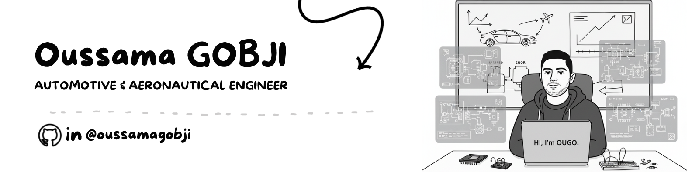

  

<h1 align="center">🧑🏻‍💻 Oussama Gobji 🚗✈️</h1>
<h3 align="center">Automotive & Aeronautical Engineer</h3>

---

## 👨‍💻 About Me

I hold a Bachelor's degree in Computer Systems Engineering and a Professional Master's degree in Automotive & Aeronautical Engineering (ENET'COM, University of Sfax), specializing in Embedded Systems, IoT, and Industrial Quality.

Currently working as a **Quality Engineer** in the automotive industry, I focus on continuous improvement, process optimization, and ensuring high standards on production lines. My background bridges the gap between technical engineering and industrial quality management.

During my End-of-Study Project at **Capgemini Engineering**, I designed, implemented, and validated a complete **AUTOSAR Classic** vehicle access ECU on an **STM32H7** microcontroller. I applied the **V-Model** and **A-SPICE** standards, verifying the system through an automated **Software-in-the-Loop (SIL)** test campaign with CI/CD.

I also have hands-on experience in industrial supervision and data analysis. At **Mecaprotec Aero**, I developed a real-time supervision tool for aeronautical equipment and parts. At **DATAVERSE**, I worked as an IT & Digital Transformation Consultant, leveraging **Power BI** and **Odoo (ERP)** to optimize processes and data visualization.

My focus is on building reliable, standards-compliant solutions while ensuring quality, traceability, and continuous improvement in fast-evolving industrial environments.

On my GitHub, you will find a collection of projects that I have designed and implemented from concept to deployment, demonstrating my ability to transform ideas into practical and scalable solutions.

I am also an IEEE member and co-founder of the ISETN Community, where I contribute to knowledge sharing and collaborative initiatives, passionate about innovation, technology, and continuous learning.

Feel free to connect with me on LinkedIn to discuss opportunities, collaborations, or technical projects.

---

  

## 💡 Skills & Tools

  <!-- 🏭 Industrial Quality & Methods -->
  
  
  
  
  
  
  
  
  
  

  <!-- 🚗 Automotive & AUTOSAR -->
  
  
  
  
  
  
  
  

  <!-- 📊 Data & Consulting -->
  
  
  
  

  <!-- ⚙️ Embedded Systems -->
  
  
  
  
  
  
  
  
  

  <!-- 🧠 Programming Languages -->
  
  
  
  
  
  

  <!-- 🧪 Testing, Validation & CI -->
  
  
  
  
  
  
  
  

  <!-- 🚀 Tools & DevOps -->
  
  
  
  
  
  

  <!-- 🧩 Databases -->
  
  
  

  <!-- 💬 Soft Skills -->
  
  

